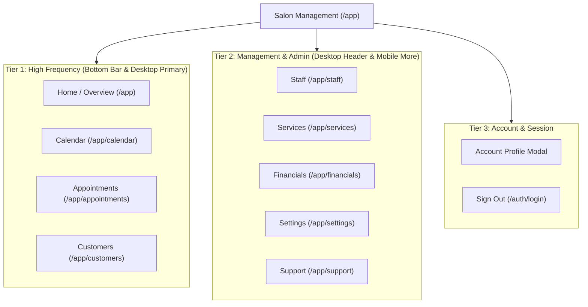
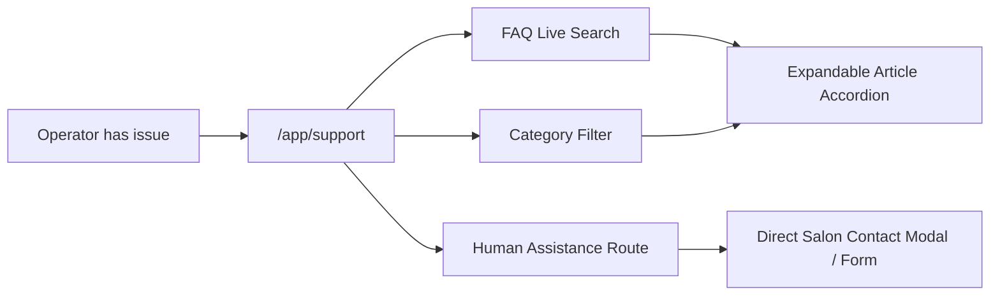

# BookYourBarber — Salon Management UX, Navigation & Responsive Architecture Specification

**Document Version:** 1.0.0  
**Date:** September 2026  
**Status:** Approved Architectural Blueprint  
**Scope:** Salon Management System (`/app/*`), Customer Booking Experience (`src/App.tsx`), Responsive Layout Framework.

---

## 1. Executive Summary & Design Vision

BookYourBarber is an integrated barbershop management platform. It unites two critical workflows under a single, coherent design language:
1. **The Customer Booking Journey**: A frictionless, mobile-first booking and payment funnel where clients can view services, pick a barber, select open slots, pay securely, and manage their reservations.
2. **Salon Operations & Management**: A focused, robust operational environment used by barbershop owners, managers, and chair barbers to run their daily schedule, monitor cash collected and card charges, manage customer relationships, configure service rosters, and access human-first platform support.

### The Shift Away from Traditional Legacy Sidebars
Most traditional B2B SaaS tools lock operators into a heavy desktop left sidebar. On small laptops and tablets, sidebars consume 200–260 pixels of precious horizontal real estate. On cellphones, they are clumsily hidden behind hamburger buttons or completely omitted, stranding barbers who try to run their shops from their smartphones.

BookYourBarber rejects this legacy paradigm:
- **On Desktop & Tablet**: A clean, top-level navigation system anchors the application. Primary operational areas sit horizontally along the header with clear typography, quick-access actions, and direct access to profile and support.
- **On Mobile Devices**: A thumb-zone ergonomic bottom navigation bar hosts the 4 high-frequency operational tabs (**Home**, **Calendar**, **Appointments**, **Customers**) plus a **More** tab that summons a structured sheet for catalog, financials, settings, support, and account controls.
- **Unified Identity**: Strict flat design (zero drop shadows, zero gradients, zero emojis, unified SVG iconography), high contrast, tactile 44px+ touch targets, and resilient typography engineered for high-turnover barbershops.

---

## 2. Architectural Principles & Zero Sidebar Mandate

### The Zero Sidebar Mandate
1. **Permanent desktop sidebars are strictly forbidden** in the Salon Management layout (`src/app/app/layout.tsx`).
2. The entire horizontal screen width on desktop is preserved for high-density operational data: daily schedules, appointment time blocks, client histories, and financial ledgers.
3. The layout switches cleanly between two primary viewport modalities:
   - **Desktop / Tablet (`md: min-width: 768px`)**: Top Header System (`h-16 border-b border-gray-200 bg-white`).
   - **Mobile Phone (`< 768px`)**: Compact Top Bar (`h-14 border-b border-gray-200 bg-white`) + Fixed Bottom Navigation Bar (`h-16 border-t border-gray-200 bg-white fixed bottom-0 left-0 right-0 z-40 safe-area-bottom`).

### Non-Negotiable Architecture Constraints
- **Preserve Application Services & Repositories**: All database and domain logic flows through existing Application Services (`AppointmentService`, `BookingService`, `AvailabilityService`, `PaymentService`, `FinancialService`) and Repositories (`SupabaseAppointmentRepository`, etc.).
- **Preserve Supabase RLS & Multi-Tenancy**: All queries remain strictly scoped to `tenantContext.tenantId`. Client code never uses the service-role key.
- **No Mock or Fake Data**: All displays must bind to verified state or live repository calls.
- **No Admin Scope Creep**: Platform administration (`/admin`) remains deferred. This specification governs exclusively `/app/*` and the customer booking shell.

---

## 3. Information Architecture & Route Mapping

The Salon Management surface is organized into clear operational tiers based on task frequency:



### Route Table
| Route | Label | Primary Audience | Key Functionality |
|---|---|---|---|
| `/app` | Home | Owner / Staff | Today's KPI metrics, today's appointments feed, quick status updates. |
| `/app/calendar` | Calendar | Owner / Barber | Day/Week visual time grid, agenda stream, appointment slot drag/tap. |
| `/app/appointments` | Appointments | Reception / Staff | List/card view of all bookings, filtering, search, record payment, cancel. |
| `/app/customers` | Customers | Reception / Owner | Client database, phone lookup, visit history, outstanding balances. |
| `/app/staff` | Staff | Owner / Manager | Barber list, working hours, commission/service assignments. |
| `/app/services` | Services | Owner / Manager | Service catalog, pricing in ZAR, duration in minutes, categories. |
| `/app/financials` | Financials | Owner | Daily takings, cash vs card reconciliation, refunds, expense tracking. |
| `/app/settings` | Settings | Owner | Salon details, opening hours, cancellation fees, booking policies. |
| `/app/support` | Support | All Users | Human-first FAQ search, real feature docs, direct contact route. |

---

## 4. Desktop Top-Level Navigation Specification

On screens with width >= 768px, navigation is delivered through a unified, 64px tall top header bar.

```
+-------------------------------------------------------------------------------------------------------------+
| [B] Fade & Edge Barbershop v  |  Home   Calendar   Appointments   Customers   Staff   Services   Financials   |
| Cape Town - Owner             |  Settings  |  [+ New Appointment]  [Support ?]  [(U) Sizwe M. v]            |
+-------------------------------------------------------------------------------------------------------------+
```

### Layout Elements & Component Hierarchy
1. **Salon Branding & Tenant Context (Left)**:
   - Square monochrome logo glyph (`w-8 h-8 bg-gray-900 text-white font-bold rounded-sm`).
   - Salon Name (`text-[14px] font-bold text-gray-900 leading-tight truncate max-w-[200px]`).
   - Location & Role Badge (`text-[11px] text-gray-500 font-medium`).
   - Switcher indicator arrow for multi-branch salons.
2. **Primary Horizontal Navigation Links (Center)**:
   - Direct links to `/app`, `/app/calendar`, `/app/appointments`, `/app/customers`, `/app/staff`, `/app/services`, `/app/financials`, `/app/settings`.
   - Inactive state: `text-[13px] font-medium text-gray-600 hover:text-gray-900 hover:bg-gray-50 px-3 py-2 rounded-sm transition-colors`.
   - Active state: `text-[13px] font-bold text-gray-900 bg-gray-100 px-3 py-2 rounded-sm border border-gray-200`.
3. **Quick Operational Action & Help (Right)**:
   - Primary Action Button: `+ New Appointment` (`bg-gray-900 text-white px-3.5 py-2 rounded-sm text-[12px] font-semibold hover:bg-gray-800`).
   - Support Icon Link: Direct link to `/app/support` with a clean SVG question mark glyph and tooltip.
   - User Profile Dropdown: Displays user initials avatar, full name, role, and a clean dropdown menu containing **My Profile**, **Salon Settings**, and **Sign out**.

---

## 5. Mobile Navigation & Fixed Bottom Tab Bar Specification

On mobile viewports (< 768px), primary navigation shifts to the bottom thumb zone, complemented by a slim top utility bar.

```
+-----------------------------------------------------+
| [B] Fade & Edge Barbershop      [Support] [+ New]   |  <- Top Bar (h-14)
+-----------------------------------------------------+
|                                                     |
|                 Operational Content                 |
|                                                     |
+-----------------------------------------------------+
|  [Home]   [Calendar]   [Appts]   [Customers] [More] |  <- Bottom Tab Bar (h-16)
+-----------------------------------------------------+
```

### The 5 Fixed Bottom Tabs
1. **Home (`/app`)**:
   - Icon: 4-square grid / dashboard icon.
   - Label: `Home`.
   - Badge: Optional alert dot if there are unpaid appointments or urgent alerts.
2. **Calendar (`/app/calendar`)**:
   - Icon: Calendar page with top binding line.
   - Label: `Calendar`.
3. **Appointments (`/app/appointments`)**:
   - Icon: Clipboard / appointment card icon.
   - Label: `Appointments`.
4. **Customers (`/app/customers`)**:
   - Icon: Two-user outline icon.
   - Label: `Customers`.
5. **More (Modal Drawer)**:
   - Icon: 3 horizontal dots or stacked hamburger menu.
   - Label: `More`.
   - Behavior: Does not route to a blank page; opens the **More Action Sheet** from the bottom.

### Mobile Bottom Bar Styling & Ergonomics
- Container: `fixed bottom-0 left-0 right-0 z-40 bg-white border-t border-gray-200 safe-area-bottom h-16 flex items-center justify-around px-1`.
- Tab Button: `flex flex-col items-center justify-center flex-1 h-full py-1 text-center select-none active:bg-gray-50`.
- Inactive Tab: `text-gray-400 hover:text-gray-600 text-[10px] font-medium`.
- Active Tab: `text-gray-900 font-bold text-[10px]`.
- Icon Size: `w-5 h-5 mb-1`.
- Touch Target: Full width of the column (\(320\text{px} / 5 = 64\text{px}\) on smallest devices, well above 48px minimum).

---

## 6. "More" Secondary Navigation Drawer & Sheet Specification

When the user taps the **More** tab on mobile, a slide-up bottom sheet animates into view, providing structured access to secondary operations, settings, support, and account management.

```
+-----------------------------------------------------+
|                     [== Grab Bar ==]                |
| More Options                                    [X] |
+-----------------------------------------------------+
| OPERATIONS & CATALOG                                |
|   [Staff]       Staff & Chair Barbers             > |
|   [Services]    Service Catalog & Pricing         > |
|   [Financials]  Revenue, Cash/Card & Refunds      > |
+-----------------------------------------------------+
| SALON CONFIGURATION                                 |
|   [Settings]    Hours, Policies & Booking Rules   > |
|   [Support]     Help Center & Contact Us          > |
+-----------------------------------------------------+
| LOGGED IN AS                                        |
|   (S) Sizwe Mkhize (Owner)                          |
|   sizwe@fadeandedge.co.za                           |
|   [ Sign Out Button ]                               |
+-----------------------------------------------------+
```

### Technical Specification of the More Sheet
- **Accessibility & Focus**: Trap focus inside sheet when opened; Escape key closes; tap on darkened backdrop closes.
- **Scroll Containment**: Max height `85vh` with `overflow-y-auto overscroll-contain` to ensure content on short phones (e.g. 568px/667px) remains completely reachable.
- **Direct Link Navigation**: Tapping any link closes the sheet and routes immediately to the target page via Next.js router.
- **Safe Area Inset**: Bottom padding dynamically respects iOS gesture navigation indicator.

---

## 7. Customer Experience vs Salon Management Cohesion

While Customer Booking and Salon Management serve different personas, they belong to the same product and must feel aesthetically unified.

### Cohesive Design Attributes
| Attribute | Customer Booking | Salon Management |
|---|---|---|
| **Color Palette** | Pure White (`#FFFFFF`), Gray-50 (`#F9FAFB`), Gray-900 (`#111827`) | Same monochrome palette with functional Gray-100/200 borders |
| **Typography** | Inter / System Sans-Serif, high contrast, strict hierarchy | Same font stack; slightly denser tabular figures (`tabular-nums`) |
| **Borders & Corners** | Rounded-2xl on mobile cards, flat 1px borders | Flat 1px border (`border-gray-200`), rounded-sm on internal controls |
| **Iconography** | Clean 24x24 / 20x20 feather-style line SVGs | Matching line SVGs, stroke width 2.0 |
| **Status Indicators** | Engineered badges with border + solid text (no colorful pills) | Identical badge components (`ApptBadge`, `PayBadge`, `SourceBadge`) |
| **Currency** | `R{amount}` formatted via `formatZAR` | `fmtR` / `formatZAR` using exact same domain helper |

---

## 8. Dedicated In-App Support Architecture & Human Contact System

Support is a first-class operational feature, accessible from both desktop (top header icon) and mobile (top bar icon + More drawer).



### Support Hub Layout (`/app/support`)
1. **Support Header**:
   - Title: `Support & Help Center`.
   - Subtitle: `Search quick answers about your salon, appointments, payments, and staff schedules.`
2. **Instant Search Field**:
   - High-contrast search input with magnifying glass icon and instant debounced keyword filtering.
   - Clears easily with an `×` button.
3. **Categorized Accordion Guides**:
   - Real, authentic articles written in natural human language, based strictly on implemented features.
4. **Human Contact Card**:
   - Dedicated direct route for issues requiring escalation:
     - Direct telephone call: `tel:0115550192` (salon emergency desk).
     - Direct email ticket: `mailto:support@bookyourbarber.co.za`.
     - In-app Support Request Form: Topic dropdown, description, contact callback number, submit with confirmation.

---

## 9. FAQ Knowledge Base (Derived from Real Implemented Features)

The Support knowledge base contains zero placeholder text. Every answer directly explains real features implemented in the code:

### Category 1: Appointments & Booking Rules
- **Q: How far in advance can clients book?**  
  *A:* By default, customers can book appointments up to 60 days in advance. Dates beyond 60 days are disabled in the booking calendar. You can customize this window in Salon Settings.
- **Q: What happens if two clients try to book the same time slot?**  
  *A:* BookYourBarber implements a 10-minute slot reservation lock. When a client selects a slot and proceeds to payment, that slot is held. If they don't complete payment within 10 minutes, the hold expires and the slot becomes available to other customers.
- **Q: How do walk-in appointments work?**  
  *A:* Click "+ New Appointment" from your dashboard or appointments screen. Select "Walk-in" as the booking source, assign a barber and service, and record cash or card payment immediately.

### Category 2: Cancellations & Refunds
- **Q: How are cancellation fees calculated?**  
  *A:* Cancellation fees follow your salon policy:
  - Cancellations > 24 hours prior: 0% fee (100% refund).
  - Cancellations between 2 and 24 hours prior: 50% fee.
  - Cancellations under 2 hours prior or no-shows: 100% fee (no refund).
- **Q: How do I issue a manual refund?**  
  *A:* Navigate to **Financials** > **Payments** or **Refunds**. Select the transaction, verify the booking reference, enter the approved refund amount and reason, and confirm. The refund is recorded and audited in the financial ledger.

### Category 3: Staff & Roster Management
- **Q: Can a client book with any available barber?**  
  *A:* Yes. The customer booking flow includes an "Any Available" option which automatically routes the appointment to the first available barber with an open chair at the requested time.
- **Q: How do I adjust barber working hours or mark a barber off?**  
  *A:* Go to **Staff** (or via **More** on mobile), select the barber's profile, and edit their weekly shifts or toggle their status to inactive. Inactive staff will not appear in the customer booking flow.

### Category 4: Payments & Cash Reconciliation
- **Q: How does card payment verification work?**  
  *A:* Online card payments are securely verified against our payment engine. Each successful charge generates a unique transaction reference and updates the appointment's payment status to "Paid".
- **Q: How do I record a cash payment received at the chair?**  
  *A:* Open the appointment details, click "Record Payment", select "Cash", verify the amount received, and tap confirm. The balance will update to paid and appear in today's cash reconciliation report.

---

## 10. Responsive Layout System & Viewport Clamping (320px to 430px+)

### Strict Container & Viewport Rules
1. **No Horizontal Overflow**: `overflow-x-hidden` on the main page wrapper prevents any component from pushing the viewport wider than the device screen width.
2. **Fluid Padding**:
   - Ultra-compact phones (320px): `px-3 py-3`.
   - Standard phones (360px–430px): `px-4 py-4`.
   - Tablets & Desktop (768px+): `px-6 py-6 max-w-6xl mx-auto`.
3. **No Outer Double Borders**:
   - Customer booking wrapper uses `w-full max-w-lg min-h-screen bg-white sm:border-x sm:border-gray-200`. On mobile screens (<640px), there are no outer borders.

---

## 11. Responsive Table-to-Card Transformation Framework

Every data grid in the operational surface must use the **Dual-Mode Presentation Pattern**:

```
+---------------------------------------------------------+
| Screen Width >= 768px: Clean Flat Desktop Table         |
| [Ref]  [Customer]  [Service]  [Staff]  [Time]  [Status] |
+---------------------------------------------------------+
| Screen Width < 768px: Interactive Touch Card List       |
| +-----------------------------------------------------+ |
| | 09:00 - #BF-8921                       [ Confirmed ]| |
| | Sipho Mthembu (082 123 4567)                        | |
| | Classic Haircut · Themba N.          [ Paid · R150 ]| |
| +-----------------------------------------------------+ |
+---------------------------------------------------------+
```

### Mobile Card Components:
1. **AppointmentCard (`Appointments.tsx`)**:
   - Header: Time + Reference pill + Status badge.
   - Body: Customer name + Service + Staff name.
   - Footer: Payment badge + Total price + Right chevron indicator.
   - Minimum tap target height: `72px`.
2. **CustomerCard (`Customers.tsx`)**:
   - Header: Customer avatar initials + Name + Segment badge (`VIP` / `Regular` / `New`).
   - Body: Phone number (clickable `tel:`), email.
   - Metrics: Visits count, total spend, last visit date.
   - Alert: Outstanding balance in bold red text if > R0.
3. **PaymentCard (`Financials.tsx`)**:
   - Header: Amount (bold `text-[16px]`) + Payment status badge.
   - Body: Customer name + Service name.
   - Footer: Timestamp + Method (`Card` / `Cash`) + Booking reference.

---

## 12. Dashboard & KPI Metric Adaptation for Small Screens

### Header Refactor
In `src/ops/Dashboard.tsx`:
- Mobile (<640px): A clean vertical stack or compact flex row with Salon Name, Date subtitle, and a single `+ New` button.
- Desktop (>=640px): Expanded row with Date, Salon Name, `+ New Appointment`, `Appointments`, and `Calendar` buttons.

### Metric Tiles Grid
- Grid specification: `grid grid-cols-2 lg:grid-cols-4 gap-2.5 sm:gap-4`.
- On 320px–360px:
  - Label: `text-[11px] font-bold uppercase tracking-wider text-gray-400`.
  - Value: `text-[18px] sm:text-[22px] font-bold text-gray-900`.
  - Subtitle: `text-[10px] text-gray-500`.

---

## 13. Calendar & Schedule Touch Strategy (Day, Agenda, Multi-staff)

### Mobile Calendar Strategy
- Desktop displays a multi-column time grid where each column represents a barber.
- On mobile viewports (<768px), horizontal multi-column grids become unreadable.
- **Solution**:
  1. Provide a **Staff Filter Strip** at the top: `[All Staff] [Themba] [Devon] [Aisha] [Ntombi]` as horizontally scrollable chips.
  2. Implement an **Agenda / Stream View** toggle for mobile: chronological list of appointment blocks with visual time indicators, barber tags, and tap-to-inspect actions.
  3. All touch slots provide minimum 48px height to prevent mis-taps.

---

## 14. Customer Booking Flow Mobile Responsive Fix Specifications (Step-by-Step)

### Step 1: Salon Landing Page
- Badges strip uses `-mx-4 px-4 overflow-x-auto scrollbar-none` with smooth touch momentum scrolling.
- "Book an Appointment" CTA anchored to bottom with safe-area bottom cushion.

### Step 2: Service Selection
- Service cards reflow gracefully: Service title, description, duration, and price in ZAR.
- Tap target: Full card is clickable with minimum 64px height.

### Step 3: Staff Selection
- Refactor from static `grid-cols-2` to responsive grid:
  `grid grid-cols-1 xs:grid-cols-2 gap-2.5 sm:gap-3`.
- Compact card padding `p-3 xs:p-4`.
- Avatars size down to `w-12 h-12 xs:w-14 xs:h-14`.

### Step 4: Date Selection
- Container padding adjusted to `px-2 xs:px-4`.
- Calendar matrix uses `gap-0.5 xs:gap-1`.
- Day cells maintain minimum `min-h-[40px] xs:min-h-[44px] aspect-square rounded-full`.

### Step 5: Time Slot Selection
- Slots grid uses `grid-cols-3 gap-2`.
- Vertical padding set to `py-2.5 xs:py-3 text-[13px]` for optimal thumb ergonomics.

### Step 6: Customer Details
- Phone number country badge replaced with clean text prefix `ZA +27` (zero emojis).
- Text inputs use minimum `text-[16px]` on mobile to prevent iOS Safari auto-zooming.

### Step 7: Reminder Channel
- Stack of 4 clean selection rows (WhatsApp, SMS, Email, None).
- High contrast radio circles; badges styled with border and text, no gradients.

### Step 8: Booking Summary
- Review card formatted as clean receipt table.
- Agreement checkbox sized at 20x20px with generous label tap zone.

### Step 9 & 10: Payment Selection & Card Entry
- Flat card preview: `bg-gray-900 border border-gray-800` (no gradients, no drop shadows).
- Monospace card number: `text-[15px] xs:text-[17px] tracking-wider`.
- Expiry and CVV inputs side-by-side with equal 50% split.

---

## 15. Safe Areas, Keyboard Offsets & Touch Target Sizing (44px/48px)

### Safe Area CSS Rules
All bottom-anchored bars (Mobile Bottom Nav, Customer CTA Bar, Mobile Sheets) must implement CSS safe-area padding:
```css
padding-bottom: max(1rem, env(safe-area-inset-bottom));
```

### Touch Target Rule
- All interactive controls have a minimum bounding box of 44x44px (W3C WCAG 2.1 Level AA) or 48x48px where possible.
- Inline text links have minimum tap padding of `py-2`.

---

## 16. Form Controls, Mobile Inputs, Modals & Action Sheets

### Mobile Bottom Sheet Pattern
Instead of centered modals that get clipped on short screens:
```tsx
<div className="fixed inset-0 z-50 flex flex-col justify-end sm:items-center sm:justify-center bg-black/50 backdrop-blur-xs">
  <div className="w-full sm:max-w-lg bg-white rounded-t-2xl sm:rounded-sm border-t sm:border border-gray-200 max-h-[90vh] flex flex-col overflow-hidden">
    {/* Sheet Header */}
    {/* Sheet Body: overflow-y-auto */}
    {/* Sheet Footer: Sticky at bottom */}
  </div>
</div>
```

---

## 17. Design System Compliance: Strict Flat Design

Every component must adhere strictly to the design system rules:
- **Zero Drop Shadows**: No `shadow-sm`, `shadow-md`, `shadow-lg`, `shadow-xl`. Elevation is communicated exclusively via 1px border contrast (`border-gray-200`).
- **Zero Gradients**: No `bg-gradient-to-*`. Surfaces use solid fills (`bg-white`, `bg-gray-50`, `bg-gray-100`, `bg-gray-900`).
- **Zero Emojis**: All icons are unified, engineered SVG lines (stroke width 1.5 to 2.5). Country flags are rendered as clean text codes (`ZA +27`) or engineered SVGs.
- **No Colorful Status Pills**: Statuses use muted backgrounds with solid borders (e.g. `border-gray-200 bg-gray-50 text-gray-700` or `border-amber-200 bg-amber-50 text-amber-800`).

---

## 18. State Management, Breadcrumbs & Route History

- The Next.js App Router (`/app/*`) is the single canonical routing shell.
- Navigation history is preserved across views.
- Deep links with query parameters (e.g., `/app/appointments?ref=BF-1001` or `/app/appointments?action=create`) open directly to the requested sub-view without lost state.

---

## 19. Performance, Viewport Assets & Mobile Network Considerations

- Next.js and Tailwind CSS bundle sizes are kept minimal.
- Images use Next.js image loading or lightweight CDN parameters (`w=400&auto=format`).
- Heavy tables are lazily transformed or unmounted on mobile to minimize DOM node count.

---

## 20. Verification, Testing Matrix & Acceptance Criteria

### Verification Gates
1. **Automated Unit Tests**: Vitest suite must pass 100% (all existing tests + new navigation/support tests).
2. **TypeScript Typecheck**: `npm run type-check` (or `tsc --noEmit`) must exit with status 0.
3. **Next.js Production Build**: `npm run build` must compile all routes cleanly without errors.
4. **Viewport Smoke Inspection Across Breakpoints**:
   - 320px (Ultra-compact mobile): Zero horizontal overflow, staff cards readable, date matrix clickable.
   - 360px (Standard compact mobile): Bottom tab bar clean, More sheet functional.
   - 375px / 390px (Mainstream iOS): Safe-area bottom padding active, header buttons aligned.
   - 412px / 430px (Large mobile): Fluid layout reflow, touch targets >= 44px.
   - 768px / 1024px / 1280px (Desktop): Top header visible, zero desktop sidebar, full tables rendered.
